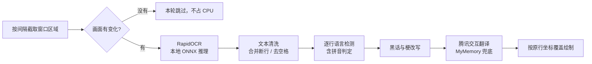

<div align="center">

# 轻工具 · LightTool

**把翻译框拖到游戏聊天框上，新消息 1 秒内原位变中文。**

为《战地 1》《战地 5》等无法输入中文、聊天只能看外文的多人游戏而做


[界面预览](#界面预览) · [核心功能](#核心功能) · [实时翻译](#实时翻译) · [快速开始](#快速开始) · [使用说明](#使用说明) · [拼音识别](#拼音识别) · [工作原理](#工作原理) · [常见问题](#常见问题)

</div>

---

## 它解决什么问题

《战地 1》《战地 5》这类游戏没有中文输入法，也常常只有外文聊天。想看懂队友在喊什么，只能切出游戏、复制、打开翻译网站、再切回来，一场对局下来手忙脚乱。

轻工具把这件事变成一次拖拽：把翻译框拖到游戏聊天框上，框内的文字**默认每秒**被识别一次（可在 1–10 秒之间调整），译文直接画在原来那一行的位置上。不需要切屏、复制、粘贴，也不需要打开翻译网站——新消息出现后约 1 秒，屏幕上就是中文。

> 游戏本身依旧不支持中文输入，本工具不会向游戏写入文字或模拟按键。它负责的是"看懂队友在说什么"。

## 界面预览

<p align="center">
  
</p>

<p align="center"><sub>悬浮窗覆盖在聊天区域上，新消息逐行原位变为中文（示意图）</sub></p>

<p align="center">
  
</p>

## 核心功能

| 能力 | 说明 |
| --- | --- |
| **实时原位翻译** | 默认每秒自动扫一遍聊天区，新消息出现即刷新；刷新间隔可在工具条上按 1–10 秒调整 |
| **随时暂停** | 工具条「暂停」按钮一点即停，不再截图、识别和请求接口，再点「继续」恢复 |
| **低资源占用** | 画面没变化时跳过 OCR，推理只用 2 个线程；挂机时 CPU 接近 0，打游戏不抢资源 |
| 多语言混排 | 英文、德文、法文、土耳其文、西班牙文逐行自动识别，统一译成中文；中文行保持原样 |
| 翻译方向切换 | 工具条分为「外语→中」「拼音→中」「中→英」三档，分别翻译外语、还原拼音、翻译中文 |
| 网络用语与黑话 | 内置 slang 规则表，`lol`、`type shit`、土耳其语 `amk` 等先做同语言中性化再翻译 |
| 拼音识别 | 带声调 `nǐ hǎo`、无声调 `ni hao`、连写 `nihao`、全大写 `NI HAO` 都能还原成汉字，本地离线词典，不占翻译接口 |
| 三滑块调节 | 「大小」「透明」「间隔」三个滑块，窗口长宽也可任意拖拽，刷新间隔 1–10 秒可选 |
| 固定玻璃工具条 | 顶部参数栏恒定 40% 透明，不随窗口透明度变淡，控件始终清晰 |
| 置顶开关 | 一键把窗口固定在最上层，游戏窗口化时不会被盖住 |
| 本地 OCR | RapidOCR + ONNX Runtime 本地推理，截图不出本机 |
| 自我排除 | 窗口自身不会出现在截图中，避免把自己的译文再识别一遍 |

## 实时翻译

悬浮窗常驻在聊天区上方，按固定节奏自动刷新，从按下启动到看懂队友说话都不需要额外操作：

```text
按设定间隔（默认 1 秒）
  └─ 截取悬浮窗区域
       ├─ 缩略图帧差比对：画面没变 → 本轮直接跳过，不跑 OCR
       └─ 画面有变 → 本地 OCR → 逐行翻译（命中缓存直接复用）→ 按原行坐标覆盖绘制
```

| 指标 | 实测 |
| --- | --- |
| 刷新间隔 | 默认 1 秒，工具条「间隔」滑块可在 1–10 秒之间调整 |
| 单次 OCR | 约 440–570 ms，仅 2 个推理线程 |
| 出译文延迟 | 通常 1 个间隔周期以内 |
| 画面静止时 | 跳过 OCR，CPU 接近 0 |
| 暂停后 | 完全不截图、不识别、不请求接口，悬浮窗保持当前译文 |
| 网络 | 只把识别出的文本发给翻译接口，截图不出本机 |

只有内容真正变化时才重新翻译：同一句话不会重复请求接口，滚动出现的新消息会在下一轮自动补上译文；聊天清空后译文随之消失，切换翻译方向时旧译文会立即清掉。

## 快速开始

### 环境要求

- Windows 10 / 11
- Python 3.10 及以上
- 可联网（翻译接口需要）

### 安装

```bash
git clone https://github.com/<your-name>/light-tool.git
cd light-tool
pip install -r requirements.txt
```

### 启动

双击 `启动.bat`，或在命令行执行：

```bash
python main.py
```

也可以直接双击 `exe/轻工具.exe` 运行，免安装 Python（单文件约 110 MB，首次启动需解包，稍慢几秒）。

启动器只有一个入口：点击「翻译模式」，悬浮窗出现后即可拖动到游戏聊天框上。

## 使用说明

1. 打开游戏，画面设置为**窗口化**或**无边框窗口**（全屏独占模式下系统置顶窗口通常无法显示）。
2. 启动轻工具，进入翻译模式。
3. 拖动悬浮窗，让它刚好覆盖聊天区域；拖动四边或右下角可调整大小。
4. 等待约 1 秒（默认间隔），框内文字按当前模式逐行显示译文；原文过长时会自动缩小字号。
5. 工具条三档：「外语→中」只翻译外语行，「拼音→中」自动还原拼音行（大小写均可），「中→英」只翻译中文行。
6. 「间隔」滑块在 1–10 秒之间调节截图识别频率：想更快出词就往左，想更省资源就往右。
7. 「透明」滑块调低可继续看清游戏画面；「置顶」开关在窗口化时保持窗口不被遮挡。
8. 「暂停」按钮一点即停，不再截图、识别和请求接口，悬浮窗保留当前译文；再点「继续」恢复识别。
9. 点右上角 `✕` 退出翻译模式，回到启动器。

## 支持的语种

| 屏幕上的内容 | 外语→中（默认） | 拼音→中 | 中→英 |
| --- | --- | --- | --- |
| 英文 / 德文 / 法文 / 土耳其文 / 西班牙文 | 中文 | 保持原样 | 保持原样 |
| 中文 | 保持原样 | 保持原样 | 英文 |
| 拼音（`nǐ hǎo`、`ni hao`、`nihao`、`NI HAO`） | 保持原样 | 还原为汉字 | 还原后译为英文 |
| 网络用语、缩写、流行梗 | 同语言中性化后译成中文 | 保持原样 | 中文行中性化后译成英文 |

「外语→中」只输出中文：小语种接口偶尔返回英文时会自动再翻一次；人名、代号等确实无法翻译的内容保持原样。

## 拼音识别

队友用拼音喊话时，切到工具条上的「拼音→中」，工具会在本地把拼音还原成汉字再显示，不送去机翻。

| 屏幕上的内容 | 判定依据 | 显示结果 |
| --- | --- | --- |
| `nǐ hǎo`、`nǐhǎo` | 检测到声调符号，直接认定 | 你好 |
| `ni hao`、`nihao` | 能切成拼音音节，至少两个音节，且含非常用英文词 | 你好 |
| `NI HAO`、`NI`、`HE HE` | 全大写字母行直接认定，大小写不影响 | 你好 / 你 / 呵呵 |
| `ma`、`he` | 「拼音→中」下单音节直接还原；其他模式需至少两个音节 | 吗 / 喝（拼音→中） |
| `SgtPepper: ni gan ma` | 冒号 / 括号前是英文昵称，剥掉后正文是拼音 | SgtPepper: 你干嘛 |

还原流程：

1. 按最长匹配把字母串切成合法音节（`zh`、`sh`、`ang` 等整体认读）；
2. `ü` 兼容 `v` 与输入法习惯的 `u`，`xue`、`lüe` 都能识别；
3. 无声调时用英文常用词表排除歧义，避免把整句英文误判成拼音；
4. 词表覆盖不到的片段交给 Pinyin2Hanzi 的离线词典做最大概率路径还原，这一步不联网；
5. 只修正 `ni` 与句末 `ma` / `le` / `de` 等高频字，其余保留词典结果。

常用短语优先走内置词表（`ni gan ma` → 你干嘛、`chi fan le ma` → 吃饭了吗、`zai na` → 在哪），词表覆盖不到的片段再交给 DAG 还原。

聊天行带英文昵称时（`SgtPepper: ni gan ma`、`[Squad] SgtPepper: chi fan le ma`、`SgtPepper ni gan ma`），昵称原样保留，只还原冒号、括号或空格之后的正文——昵称切不成拼音才不会连累整行被判成非拼音。

「拼音→中」下不分大小写：`NI HAO`、`ni hao`、`Ni Hao` 都会还原成汉字，单个音节（`ni`、`ma`）和常用短语（`ni gan ma`、`chi fan le ma`、`zai na`）也能稳定还原，结果直接显示中文，断网也能用；「中→英」下先还原成汉字，再译成英文；「外语→中」不处理拼音，保持原样。离线词库缺失时拼音识别自动跳过，其余功能不受影响。

## 工作原理



每轮先做一次缩略图帧差比对：画面静止时整轮直接跳过，OCR 根本不启动；识别结果和译文都带缓存，同一句话不会重复请求翻译接口。

窗口采用三层结构，保证"参数栏固定透明、正文可调透明、控件永远清晰"：

- **背景层**：绘制可调透明度的圆角底色，鼠标穿透，不参与截图；
- **工具条层**：顶部 80px 的玻璃底色，固定 40% 透明；
- **界面层**：控件、边框与译文块，始终不透明，位于最上层。

三层窗口通过一次 `DeferWindowPos` 批量提交位置与大小，拖动和缩放时边框不会错位抖动。

## 项目结构

```text
light-tool/
├── main.py               启动器
├── translate_window.py   悬浮窗：三层窗口、原位覆盖、拖拽与滑块
├── translate_engine.py   语言检测与翻译服务
├── ocr_engine.py         RapidOCR 封装
├── slang.py              各语言网络用语 / 黑话替换表
├── pinyin.py             拼音识别与还原
├── 启动.bat              Windows 一键启动
├── requirements.txt
├── docs/                 README 截图
├── LICENSE
└── README.md
```

## 常见问题

**识别不到文字？**
确认游戏是窗口化或无边框窗口；全屏独占会挡住置顶窗口。文字过小或背景对比度太低时，把悬浮窗放大到聊天区域即可。

**一直显示"翻译失败"？**
翻译依赖公共免费接口，需要联网，偶发限流时稍等片刻会自动恢复。本地 OCR 不联网也能识别，只是没有译文。

**实时翻译的实际延迟有多大？**
一轮默认 1 秒（可按间隔滑块调整）：本地 OCR 占 0.4–0.6 秒，变化后的第一条译文通常在一个间隔周期内出现。画面静止时整轮直接跳过，不产生额外开销；翻译接口偶发变慢时只会影响那一轮的出词速度，不影响下一轮扫描。

**什么时候该用「暂停」？**
切到别的窗口、看录像或只想保留当前译文时点一下「暂停」，截图、OCR 和接口请求全部停止，占用归零；再点「继续」会在下一轮重新识别当前画面。

**会把我的截图上传吗？**
不会。截图只在本机做 OCR，只有识别出的文本会发送给翻译接口。

**拼音识别不出来？**
先确认工具条切到了「拼音→中」。该模式下大小写、单音节都会自动识别：`NI HAO`、`ni hao`、`Ni`、`ni gan ma` 都能还原。行首的英文昵称会被当成前缀剥掉（`SgtPepper: ni gan ma` → `SgtPepper: 你干嘛`），不会拖累后面的正文。OCR 对声调符号的识别受字体影响，声调丢失时会退回无声调规则判断。

**拼音和英文混在一行怎么办？**
昵称部分原样保留，只还原正文；正文里只要有一个词切不成拼音音节（如 `gg wp`），这一段就按原样处理，不做强行还原。

**为什么没有搜题模式？**
按规划已移除，只保留翻译模式，保持工具轻量。

**透明度拉到 0 会完全消失吗？**
不会，背景最低保留 2% 便于继续拖拽；工具条与控件不受透明度影响。

**会被反作弊误判吗？**
本工具不读写游戏内存、不注入进程、不模拟按键，只做屏幕取词与窗口置顶。是否使用请结合游戏用户协议自行判断。

## 已知限制

- 仅支持 Windows；
- 翻译需要联网，公开接口不保证 100% 可用；
- 逐行原位覆盖按 OCR 行框对齐，字体或行高特殊时可能出现轻微上下偏移；
- 艺术字体、强光照、低对比度背景下识别率会下降；
- 单词级歧义（如 `shi` 可作“是/十”）按上下文取舍；行首英文昵称会自动剥掉，但正文里中英混排的片段不做局部还原，必要时改用全大写拼音更稳定。

## 参与贡献

欢迎提交 Issue 与 Pull Request。项目刻意保持轻量：只依赖标准库、`tkinter` 与少量必要第三方包，新增功能请优先考虑能否在现有模块内完成。

```bash
git checkout -b feature/your-idea
git commit -m "feat: your idea"
git push origin feature/your-idea
```

## 许可证

[MIT](LICENSE)

## 免责声明

本项目与 Electronic Arts、DICE 无关，未使用任何游戏资源。工具仅用于辅助阅读屏幕文字，请遵守对应游戏的用户协议。
