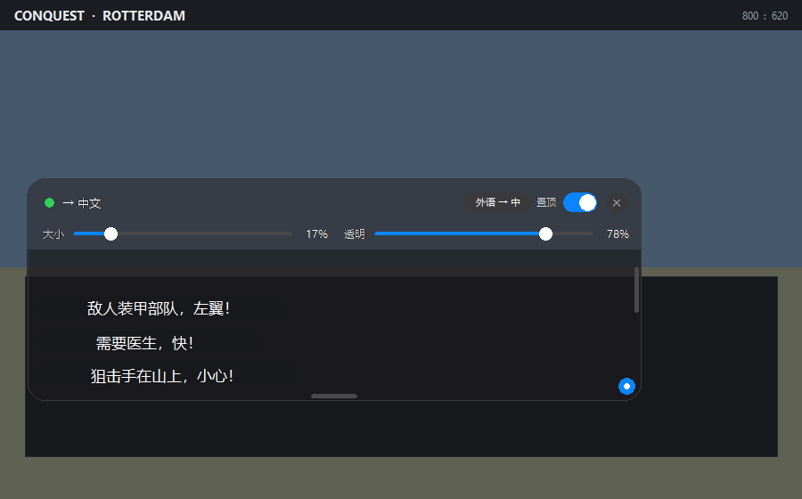
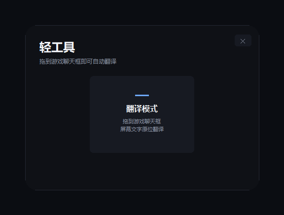
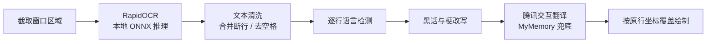

<div align="center">

# 轻工具 · LightTool

**把翻译框拖到游戏聊天框上，队友说什么，屏幕里就是中文。**

为《战地 1》《战地 5》等无法输入中文、聊天只能看外文的多人游戏而做


[界面预览](#界面预览) · [快速开始](#快速开始) · [使用说明](#使用说明) · [工作原理](#工作原理) · [常见问题](#常见问题)

</div>

---

## 它解决什么问题

《战地 1》《战地 5》这类游戏没有中文输入法，也常常只有外文聊天。想看懂队友在喊什么，只能切出游戏、复制、打开翻译网站、再切回来，一场对局下来手忙脚乱。

轻工具把这件事变成一次拖拽：把翻译框拖到游戏聊天框上，框内的文字每 0.9 秒被识别一次，译文直接画在原来那一行的位置上。不切屏、不复制、不查词典。

> 游戏本身依旧不支持中文输入，本工具不会向游戏写入文字或模拟按键。它负责的是"看懂队友在说什么"。

## 界面预览

<p align="center">
  
</p>

<p align="center"><sub>悬浮窗覆盖在聊天区域上，英文 / 德文聊天逐行原位变为中文（示意图）</sub></p>

<p align="center">
  
</p>

## 特性

| 能力 | 说明 |
| --- | --- |
| 原位覆盖翻译 | 译文按 OCR 得到的行坐标绘制，直接盖住原文，类似微信翻译 |
| 多语言混排 | 英文、德文、法文、土耳其文、西班牙文逐行自动识别，统一译成中文；中文行保持原样 |
| 翻译方向切换 | 工具条可在「外语 → 中」与「中 → 英」之间切换，后者只翻译中文行 |
| 网络用语与黑话 | 内置 slang 规则表，`lol`、`type shit`、土耳其语 `amk` 等先做同语言中性化再翻译 |
| 拼音识别 | 支持带声调与不带声调的拼音，还原成汉字后直接显示中文（`ni hao` → 你好） |
| 双滑块调节 | 「大小」「透明」两个 0–100 滑块，窗口长宽也可任意拖拽 |
| 固定玻璃工具条 | 顶部参数栏恒定 40% 透明，不随窗口透明度变淡，控件始终清晰 |
| 置顶开关 | 一键把窗口固定在最上层，游戏窗口化时不会被盖住 |
| 本地 OCR | RapidOCR + ONNX Runtime 本地推理，截图不出本机 |
| 自我排除 | 窗口自身不会出现在截图中，避免把自己的译文再识别一遍 |

## 快速开始

### 环境要求

- Windows 10 / 11
- Python 3.10 及以上
- 可联网（翻译接口需要）

### 安装

```bash
git clone https://github.com/<your-name>/light-tool.git
cd light-tool
pip install -r requirements.txt
```

### 启动

双击 `启动.bat`，或在命令行执行：

```bash
python main.py
```

启动器只有一个入口：点击「翻译模式」，悬浮窗出现后即可拖动到游戏聊天框上。

## 使用说明

1. 打开游戏，画面设置为**窗口化**或**无边框窗口**（全屏独占模式下系统置顶窗口通常无法显示）。
2. 启动轻工具，进入翻译模式。
3. 拖动悬浮窗，让它刚好覆盖聊天区域；拖动四边或右下角可调整大小。
4. 等待约 0.9 秒，框内外语会逐行变中文；原文过长时会自动缩小字号。
5. 工具条上的「外语 → 中」按钮可切换为「中 → 英」，只翻译中文聊天行。
6. 「透明」滑块调低可继续看清游戏画面；「置顶」开关在窗口化时保持窗口不被遮挡。
7. 点右上角 `✕` 退出翻译模式，回到启动器。

## 支持的语种

| 屏幕上的内容 | 外语 → 中（默认） | 中 → 英 |
| --- | --- | --- |
| 英文 / 德文 / 法文 / 土耳其文 / 西班牙文 | 中文 | 保持原样 |
| 中文 | 保持原样 | 英文 |
| 拼音（`nǐ hǎo`、`ni hao`） | 还原为汉字（中文） | 还原后译为英文 |
| 网络用语、缩写、流行梗 | 同语言中性化后译成中文 | 中文行中性化后译成英文 |

## 工作原理



窗口采用三层结构，保证"参数栏固定透明、正文可调透明、控件永远清晰"：

- **背景层**：绘制可调透明度的圆角底色，鼠标穿透，不参与截图；
- **工具条层**：顶部 80px 的玻璃底色，固定 40% 透明；
- **界面层**：控件、边框与译文块，始终不透明，位于最上层。

三层窗口通过一次 `DeferWindowPos` 批量提交位置与大小，拖动和缩放时边框不会错位抖动。

## 项目结构

```text
light-tool/
├── main.py               启动器
├── translate_window.py   悬浮窗：三层窗口、原位覆盖、拖拽与滑块
├── translate_engine.py   语言检测与翻译服务
├── ocr_engine.py         RapidOCR 封装
├── slang.py              各语言网络用语 / 黑话替换表
├── pinyin.py             拼音识别与还原
├── 启动.bat              Windows 一键启动
├── requirements.txt
├── docs/                 README 截图
├── LICENSE
└── README.md
```

## 常见问题

**识别不到文字？**
确认游戏是窗口化或无边框窗口；全屏独占会挡住置顶窗口。文字过小或背景对比度太低时，把悬浮窗放大到聊天区域即可。

**一直显示"翻译失败"？**
翻译依赖公共免费接口，需要联网，偶发限流时稍等片刻会自动恢复。本地 OCR 不联网也能识别，只是没有译文。

**会把我的截图上传吗？**
不会。截图只在本机做 OCR，只有识别出的文本会发送给翻译接口。

**为什么没有搜题模式？**
按规划已移除，只保留翻译模式，保持工具轻量。

**透明度拉到 0 会完全消失吗？**
不会，背景最低保留 2% 便于继续拖拽；工具条与控件不受透明度影响。

**会被反作弊误判吗？**
本工具不读写游戏内存、不注入进程、不模拟按键，只做屏幕取词与窗口置顶。是否使用请结合游戏用户协议自行判断。

## 已知限制

- 仅支持 Windows；
- 翻译需要联网，公开接口不保证 100% 可用；
- 逐行原位覆盖按 OCR 行框对齐，字体或行高特殊时可能出现轻微上下偏移；
- 艺术字体、强光照、低对比度背景下识别率会下降。

## 参与贡献

欢迎提交 Issue 与 Pull Request。项目刻意保持轻量：只依赖标准库、`tkinter` 与少量必要第三方包，新增功能请优先考虑能否在现有模块内完成。

```bash
git checkout -b feature/your-idea
git commit -m "feat: your idea"
git push origin feature/your-idea
```

## 许可证

[MIT](LICENSE)

## 免责声明

本项目与 Electronic Arts、DICE 无关，未使用任何游戏资源。工具仅用于辅助阅读屏幕文字，请遵守对应游戏的用户协议。
